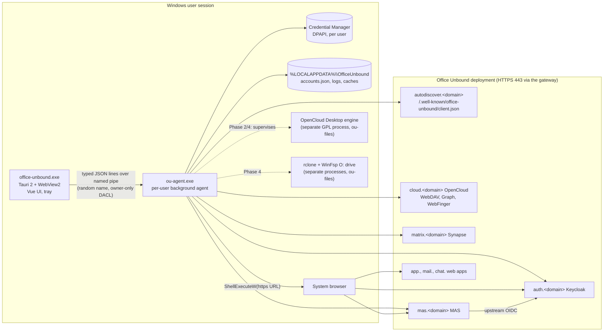

# ADR-0022: Office Unbound Desktop (Windows first): Tauri 2 GUI, per-user Rust agent, reuse of the existing services

Status: **Proposed: Implementing** (owner brief 2026-11-25, [desktop-app-brief.md](../requirements/desktop-app-brief.md)). Phase 0 (this
document) and the Phase 1 foundation are on branch `desktop-windows`. Nothing here is deployed, and nothing has run on a real Windows
computer yet: see section 12. Status words: ADR-0000. Builds on [desktop-connector.md](../requirements/desktop-connector.md),
[onedrive-and-file-sharing.md](../requirements/onedrive-and-file-sharing.md) (ODB-C), [office-unbound-connect.md](../requirements/office-unbound-connect.md)
(device enrolment, a separate project) and ADR-0015 (artifact delivery).

## 1. What exists on the reference deployment (verified read-only on officeunbound8, 2026-11-25)

| Service | Public name | Check | Result | Consequence |
|---|---|---|---|---|
| Keycloak realm `ou` | `auth.<domain>` | `/.well-known/openid-configuration` | 200; S256, revocation, device-authorization and end-session endpoints present | System-browser PKCE sign-in; RFC 7009 revocation on sign-out |
| Desktop OIDC client | (realm) | catalog `blueprints/catalog/templates/identity/realm.json` | `OpenCloudDesktop`: public, PKCE S256, redirect `http://127.0.0.1`, `offline_access` optional | Used by Phase 1 without any realm change; dedicated client proposed (section 5.3) |
| OpenCloud 9.1.0 | `cloud.<domain>` | `/status.php`, WebFinger `acct:doctest@officeunbound.com` | 200; WebFinger returns the issuer `https://auth.officeunbound.com/realms/ou` | Discovery fallback that works today; files over WebDAV/Graph with bearer tokens |
| Matrix Synapse | `matrix.<domain>` | `/_matrix/client/versions`, `/.well-known/matrix/client`, `/v3/login` | 200; spec up to v1.17; well-known names MAS; login flows `m.login.sso` (`oauth_aware_preferred`) + `m.login.token` | Next-gen Matrix auth (MSC3861): the client signs in through MAS, not with a password |
| MAS | `mas.<domain>` | `/.well-known/openid-configuration`, `/_matrix/client/v1/auth_metadata` | 200; S256, `registration_endpoint` (dynamic client registration), device-code grant | Chat module's own OAuth session; MAS upstream is Keycloak, so the browser's Keycloak cookie makes it a silent second sign-in |
| Element Web | `chat.<domain>` | `/config.json` | 200; homeserver `matrix.officeunbound.com`; Jitsi `null`; group calls off | Chat "open in browser" works; no meetings backend configured |
| Jitsi | `meet.<domain>` | DNS | **name does not resolve** | Meetings: "not available on this deployment" (no claim) |
| Mail web, autodiscover | `mail.<domain>`, `autodiscover.<domain>` | TLS + HTTP | both answer with a valid certificate (autodiscover 404 for our path today) | Mail/calendar/contacts open in the browser; autodiscover host carries the proposed client document |
| Portal | `app.<domain>` | HTTP | 303 to sign-in | "Portal" quick action |

## 2. Decision

1. **Tauri 2** GUI (Rust + system WebView2, Vue 3 + TypeScript, the console's design tokens), plus a separate **per-user background
   agent** `ou-agent.exe` (Rust, tokio). No Windows service: nothing here needs SYSTEM rights, and a per-user process cannot touch other
   users' data.
2. **Reuse the deployment as it is**: Keycloak for sign-in, OpenCloud for files, Synapse/MAS for chat, gromox web apps for mail/calendar/
   contacts, Collabora through OpenCloud. The app adds no server and no new public name. One public IP stays sufficient.
3. **Platform-neutral protocol code in `ou-core`** (discovery, OIDC, sessions, URL policy, redaction, safety rules, IPC types) so future
   macOS/Linux/mobile clients reuse it; Windows specifics are behind `cfg(windows)` (Credential Manager, named pipe, ShellExecuteW).
4. **Discovery needs no new DNS record** (owner, 2026-11-25): HTTPS client document on `autodiscover.<domain>` (a record every tenant
   already publishes), falling back to OpenCloud WebFinger on `cloud.<domain>`. DNS TXT/SRV is never used to choose the server.

## 3. Components and interfaces



| Crate / part | Owner (branch) | Role | Public interface others rely on |
|---|---|---|---|
| `desktop/crates/ou-core` | lead (`desktop-windows`) | protocol + policy core | `http::client()` (verified TLS, HTTPS only); `discovery::{parse_input, discover, Deployment}`; `oidc::{ProviderMetadata, sign_in, refresh, revoke}`; `session::{Session, TokenProvider, TokenError, authorized}`; `secrets::{SecretStore, AccountSecrets, platform_store}`; `accounts::{Account, Registry}`; `urlpolicy`; `redact::redact`; `safety` (generic rules); `ipc` (closed request set); `testing` (mock IdP, feature `test-support`) |
| `desktop/crates/ou-agent` | lead | background process | lib: `client::request(root, &Request)`, `endpoint`, `state::Agent`; bin `ou-agent [--status\|--quit\|--version]` |
| `desktop/app` (+ `src-tauri`) | lead | GUI, tray, settings, first run | Tauri commands `agent(req)` (all requests except `Shutdown`), `app_info`, `set_autostart` |
| `desktop/crates/ou-files` | files (`desktop-files`, merged) | Phase 2/4: supervised `opencloudcmd` runs (per-run app token in the environment, deleted afterwards), guard (`Hold` bound to a plan id), WebDAV/TUS client, rclone+WinFsp mapped drive; decisions in [files-decision.md](../desktop/files-decision.md) | consumes `TokenProvider`, `http::transfer_client()`, `Account.sync_root`, `safety`; IPC `ApprovePlan`/`RejectPlan`, `AccountStatus.held`/`.drive`; `ou-agent token --account <id>` for rclone's `bearer_token_command` |
| `desktop/crates/ou-chat` | chat (`desktop-chat`) | Phase 3: Matrix via MAS | builds a second `Session` (secret name `refresh-matrix`, MAS issuer from `/_matrix/client/v1/auth_metadata`) |
| `.github/workflows/desktop-*.yml` | winci (`desktop-winci`) | windows-latest build + tests, installer artifact | runs `cargo test` (incl. the Credential Manager contract test) and the bundle on real Windows |
| portal/console download routes | download (`desktop-download`) | installer delivery from the deployment's own UI via the ICS artifact service | consumes the installer + SHA-256 produced by the build |

Rules for module authors: tokens are obtained only through `TokenProvider::access_token(url)` (refuses foreign origins); `TokenError::
SignedOut` means pause, never delete; new IPC requests are added to `ou_core::ipc::Request` as typed variants (no generic pass-through);
logging goes through `redact`.

## 4. Technology evaluation

| Option | Fit | Verdict |
|---|---|---|
| **Tauri 2** (MIT/Apache-2.0) + WebView2 | Small (installer ~3-4 MB), Rust for native/background code, Vue reuse of console tokens, capability-based IPC, NSIS/MSI bundlers, per-user install | **Chosen** |
| Qt 6 (LGPL-3.0/GPL) + C++/QML | Mature native widgets, OpenCloud Desktop itself is Qt; but no reuse of the web UI/tokens, LGPL relinking duties for static builds, larger install (~40 MB) | Rejected for the shell; stays inside the OpenCloud engine |
| Electron (MIT) | Large (~100 MB+), bundles Chromium updates on us, Node in the trust boundary | Rejected |
| WinUI 3 / .NET (MIT) | Native Windows look, but Windows-only and no code reuse for later platforms | Rejected |
| Flutter (BSD) | Cross-platform, but no reuse of the Vue/CSS design system, weak tray/shell integration | Rejected |

WebView2 runtime: Microsoft, freely redistributable, built into Windows 11 and shipped to Windows 10 through Edge; the installer runs
the Evergreen bootstrapper only if it is missing (install-time download from Microsoft, the only third-party contact; offline installer
variant possible).

## 5. Identity and sign-in

### 5.1 Discovery (decision: no new DNS record)
Input is an e-mail address or a server URL (`ou_core::discovery`). Order, each over HTTPS with OS trust-store validation:
1. `https://autodiscover.<domain>/.well-known/office-unbound/client.json` (schema v1: `issuer`, `client_id`, `files`, `portal`, `matrix`,
   `mail`, `chat_web`, `name`). **Needs a static route** on the web server that answers `autodiscover.<domain>` (a CNAME of `mail.<domain>`,
   `blueprints/catalog/components/groupware.yaml`, so the mail VM's web server; catalog change, not on this branch yet). No DNS change:
   every tenant already publishes `autodiscover.<domain>`. Deployments without groupware use step 2.
2. OpenCloud WebFinger `https://cloud.<domain>/.well-known/webfinger?resource=acct:<email>` (works today, verified above); service URLs
   are then derived (`app.`, `chat.`, `mail.`, Matrix from `matrix.<domain>/.well-known/matrix/client`).
3. For a typed URL: the same documents on that host.
Every service host must be the domain or a subdomain of it; anything else is listed as "outside your domain" and needs explicit
confirmation. The user always confirms the deployment (name and sign-in host) before the browser opens. Because no record is added,
`netsettings.requirements_for` and the DNS checkers need no new row; the checker should however verify that `autodiscover.<domain>`
serves the client document once the gateway route exists (follow-up after 0.13.8 lands on main).

### 5.2 OIDC
Authorization Code + PKCE S256 in the system browser (RFC 8252): loopback listener, redirect `http://127.0.0.1:<ephemeral>` without a path (Keycloak ignores only the port of a registered loopback URI; `.../` was refused live with "Invalid parameter: redirect_uri"), `state` (constant-time
compare) and `nonce`, strict metadata validation (exact issuer, all endpoints https and on the issuer origin, S256 offered), ID token
checked for iss/aud/exp/nonce (received over verified TLS from the token endpoint), scopes `openid profile email offline_access`.
MFA is whatever Keycloak requires; the app never sees a password. Refresh tokens rotate; the rotated token is persisted before use.
Sign-out revokes the refresh token (RFC 7009). A refused refresh (`invalid_grant`) deletes the dead token and shows "signed out"; local
files are never touched. A keep-alive refresh runs every 12 h (Keycloak offline sessions idle out after 30 days by default); there is
no other background polling.

### 5.3 Proposed dedicated client (owner decision; not registered anywhere)
Phase 1 uses `OpenCloudDesktop` (already in every catalog realm). A dedicated client separates the desktop app's sessions from the
OpenCloud desktop engine's, lets admins revoke it alone, and is announced through the client document. Proposed catalog entry
(`blueprints/catalog/templates/identity/realm.json`, new deployments; existing ones through a typed `identity.realm.client.ensure`
action, which does not exist yet):

```json
{ "clientId": "ou-desktop", "name": "Office Unbound Desktop", "enabled": true, "protocol": "openid-connect",
  "publicClient": true, "standardFlowEnabled": true, "implicitFlowEnabled": false, "directAccessGrantsEnabled": false,
  "serviceAccountsEnabled": false, "redirectUris": ["http://127.0.0.1"], "webOrigins": [],
  "attributes": { "pkce.code.challenge.method": "S256", "post.logout.redirect.uris": "+",
                  "backchannel.logout.revoke.offline.tokens": "true", "oauth2.device.authorization.grant.enabled": "false" },
  "defaultClientScopes": ["web-origins", "profile", "roles", "basic", "email"], "optionalClientScopes": ["offline_access"] }
```

### 5.4 Matrix (owned by `ou-chat`)
Synapse delegates auth to MAS (verified). The chat module runs the same PKCE flow against the MAS issuer; MAS forwards to Keycloak,
whose browser session makes it silent. Two sessions, revoked separately; disabling a user in Keycloak ends both at their next refresh
(MAS upstream session) - to be measured. MAS needs a client: dynamic registration (MSC2966, how Element X does it) creates server state
per install, a static MAS client in the catalog does not; choice belongs to the chat module and the owner. End-to-end encryption keys
stay in the Matrix SDK store, encrypted with a key held in Credential Manager.

### 5.5 Secrets, accounts and isolation
Credential Manager generic credentials `OfficeUnbound/<account-id>/<name>`, `CRED_PERSIST_LOCAL_MACHINE` (not roaming), DPAPI-protected;
2560-byte limit enforced. Only refresh tokens are stored; access tokens live in agent memory; `TokenSet` has a redacting `Debug`.
`accounts.json` holds no secret (tested). Each account has its own id, data directory, secret prefix and **origin allowlist**: a token is
attached only to its deployment's exact origins, so a token of tenant A can never be sent to tenant B or a third party.

## 6. Process model and local security
- One agent per user (single instance via the endpoint), started by the GUI or at login (`--minimized`, HKCU Run via
  tauri-plugin-autostart). Closing the window hides it; tray "Quit Office Unbound" stops GUI and agent.
- Endpoint: Windows named pipe, 128-bit random name published only in `%LOCALAPPDATA%\OfficeUnbound\agent.endpoint`, first-instance
  flag, remote clients rejected, protected DACL `D:P(A;;GA;;;OW)(A;;GA;;;SY)`. Dev/Linux: Unix socket 0600 in a 0700 directory.
- Protocol: newline JSON, 64 KiB line cap, closed request set with `deny_unknown_fields`; ids validated; no exec/fetch/file request.
- External URLs: https only, no userinfo, exact deployment origins only, opened with `ShellExecuteW` (never `cmd /c start`).
- Webview: strict CSP (`default-src 'self'`, no inline script, no remote content), no shell/fs/http plugins, capability file allows only
  the app's commands and window show/hide/focus; `Shutdown` is refused from the webview.
- Logs: redacted (bearer, JWT, `code`, `state`, `*_token`, `password`), rotated at 1 MiB; no telemetry.

## 7. Data safety (design; sync-level enforcement is `ou-files`)
Generic rules in `ou_core::safety`, used by every sync path: sync-root marker file (a missing, unmounted or foreign folder is "Missing",
never "deleted"); hold when a run would delete everything, more than 200 items, or more than 30 % of at least 20 known items, or when
the server listing was incomplete; signed-out/offline pauses; Windows name rules (reserved names, invalid characters, trailing dot/space,
255-char names, MAX_PATH), case-insensitive collisions, and overlap checks so a sync root never sits inside a mapped drive or another
account's root. Never silent overwrite: conflicts become conflict copies (engine behaviour, T07). Note for `ou-files`: the headless
engine (`opencloudcmd`) authenticated with OpenCloud app tokens in T07, and app tokens are not revoked on user disable today
(user-lifecycle-results.md); the GUI path must use OIDC tokens.

## 8. Installer and updates
Tauri NSIS bundle, per-user install (`%LOCALAPPDATA%\Programs`), no admin rights, no bundled extras; the agent ships as a sidecar next to
the GUI. Development builds are cross-compiled on Linux (GNU ABI, mingw-w64, `desktop/scripts/build-windows-installer.sh`); the release
build should come from the Windows CI job (MSVC ABI). **Unsigned alpha**: SmartScreen warns; no paid certificate (ADR-0007). Updates:
Tauri updater with its own Ed25519-signed manifest is possible at zero cost, but delivery goes through the deployment's own UI first
(desktop-download); automatic updates stay off until the signed channel exists. Uninstall removes the program; account data and
Credential Manager entries are removed by "Remove account" (an uninstaller cleanup hook is a follow-up).

## 9. Licences (checked against upstream licence files when the dependency is added; inventory entries in third-party-inventory.md)

| Component | Licence | Use | Compatibility with AGPL-3.0 app |
|---|---|---|---|
| Tauri 2, tauri-plugin-* | MIT / Apache-2.0 | linked | yes |
| tokio, reqwest, rustls, serde, url, sha2, base64, thiserror, windows-sys | MIT / Apache-2.0 | linked | yes |
| ring | ISC + OpenSSL-style (BoringSSL parts) | linked | yes (permissive) |
| Vue 3, Vite | MIT | bundled / build | yes |
| IBM Plex fonts | SIL OFL 1.1 | bundled | yes (licence file shipped) |
| WebView2 runtime | Microsoft proprietary, free redistribution | system component, not bundled | not linked; system library |
| NSIS | zlib/libpng + bzip2 | build tool, stub in installer | yes |
| mingw-w64 runtime (dev builds) | ZPL/MIT-style + GCC runtime exception | linked | yes |
| OpenCloud Desktop engine | GPL-2.0-or-later (to verify in its COPYING) | **separate process**, driven by command line/config, not linked | aggregation, no linking: no licence conflict; source offer kept with the bundle if redistributed |
| rclone | MIT | separate process | yes |
| WinFsp | GPL-3.0 with FLOSS exception | separate driver/installer | yes (FLOSS exception; redistribution terms to confirm) |
| matrix-rust-sdk | Apache-2.0 | candidate for `ou-chat` | yes |
| Element Web | AGPL-3.0 (since 2023) | already deployed server-side; embedding is the chat module's choice | yes |

## 10. Milestones

| Phase | Scope | Exit evidence | State (2026-11-25) |
|---|---|---|---|
| 0 | this ADR, verified service table | doc + read-only checks | done |
| 1 | core, agent, GUI shell, tray, settings, discovery, PKCE, Credential Manager, installer | Linux tests; live PKCE against officeunbound8; cross-built installer; **real-Windows run** | Implementing (Windows run outstanding) |
| 2 | files (ou-files): engine, sync root, status, conflicts, selective sync | file-integrity tests on Windows | Planned |
| 3 | chat (ou-chat): MAS sign-in, rooms, messages, notifications | send/receive test against the lab | Planned |
| 4 | mapped drive, spaces, Files On-Demand (only if proven on Windows) | M0/M1 of desktop-connector | Planned |
| 5 | meetings (needs Jitsi deployed), mail/calendar/contacts launches, documents | per service | Planned |
| 6 | enrolment/revocation (with Connect), policies, MSI/silent install, signed updates, security review | | Planned |
| 7 | macOS/Linux/mobile | roadmap only | Planned |

## 11. Risks
WebView2 missing on locked-down Windows 10 (bootstrapper needs internet; offline variant); SmartScreen blocks unsigned installers in some
fleets; loopback redirect blocked by local firewalls/EDR (fallback: device-code grant, which Keycloak and MAS both offer); Keycloak
offline-session limits; OpenCloud engine CLI auth (app tokens) vs OIDC; Files On-Demand depends on the upstream cfapi integration;
MAS client registration model; GNU-ABI dev builds differ from the MSVC release build.

## 12. Acceptance tests and current evidence
Brief section 15 lists 15 tests; this phase covers the ones below. Everything else is open.

| # | Test | Evidence now | Missing |
|---|---|---|---|
| 1 | fresh install + first-run login | Linux: agent process test (mock IdP), vitest first-run flow; **live from Linux against officeunbound8: 8/8** (discovery from `doctest@officeunbound.com` via WebFinger, metadata, PKCE sign-in 1.8 s with client `OpenCloudDesktop`, offline refresh token, WebDAV PROPFIND 207 through `TokenProvider` after a refresh, foreign origin refused, revoke 24 ms, revoked token refused) | run the installer on Windows 10 and 11 |
| 2 | MFA + token renewal | refresh rotation + persistence tested (mock); MFA is Keycloak's | doctest has no MFA; Windows run |
| 10 | revocation | mock: refused refresh → SignedOut, token deleted; sign-out revokes | measure on the live stack from Windows |
| 12 | no credential leakage | redaction tests; settings/log scan in the agent process test | scan a real Windows profile after use |
| 14 | org isolation | origin allowlist + secret prefixes tested | two real deployments |
| - | Credential Manager backend | contract test exists (`cfg(windows)`) | execute on Windows (CI job) |
| - | named pipe DACL | code compiles for Windows | connect as another user must fail (Windows) |

## 13. Owner decisions needed
1. **Dedicated OIDC client `ou-desktop`** (section 5.3): add to the catalog realm and register on existing deployments through a typed
   action (not done: a live realm change). Until then the app uses the existing `OpenCloudDesktop` client.
2. **Client document route** on `autodiscover.<domain>` (section 5.1, catalog change in groupware's web server). No DNS record needed.
3. **Build infrastructure:** the dev installer is cross-built on Linux (GNU ABI). A free GitHub Actions `windows-latest` job (public repo)
   should produce the MSVC release build and run the Windows-only tests (Credential Manager, named pipe); the winci branch owns it.
4. **Signing:** ship unsigned alpha installers with the SmartScreen warning (zero cost), or approve a certificate later.
5. **WebView2 on Windows 10:** keep the download bootstrapper (needs internet at install) or ship the offline runtime (+~150 MB).
6. Matrix client registration with MAS: dynamic registration per install vs a static catalog client (section 5.4).
